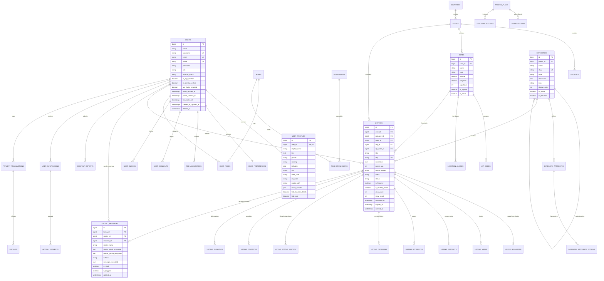

# Database Architecture & Entity-Relationship Specification: LocalDateHub

**Author:** Principal Software Architect & Database Engineer  
**Date:** November 2026  
**Status:** Approved Master Schema Specification  
**Version:** 2.0.0 (Phase 02 Implementation)  
**Target RDBMS:** MySQL 8.0+ / 8.4+ (InnoDB Engine)  
**Charset & Collation:** `utf8mb4` / `utf8mb4_unicode_ci`

---

## 1. Architectural Principles

LocalDateHub's database architecture is designed for a high-volume, location-based personal classifieds platform in the United States. It adheres to the following foundational principles:

1. **Normalized & Relational Integrity:** Full foreign key constraints with explicit referential actions (`cascadeOnDelete`, `nullOnDelete`).
2. **Encrypted Field-Level Privacy:** Sensitive contact details (message contents, unmasked phone numbers, external handles) are encrypted at rest using AES-256-CBC via Laravel's `encrypted` cast.
3. **Anti-Triangulation Geolocation:** Dual coordinate model with raw coordinates (`latitude`, `longitude`) strictly isolated from public views, and fuzzed coordinates (`fuzzed_latitude`, `fuzzed_longitude`) offset by 300m–800m.
4. **Dynamic Category & Attribute Engine:** EAV-hybrid model where categories and attributes are 100% database-driven (never hardcoded), allowing administrators to configure custom fields per personal category (M4W, W4M, M4M, W4W, Activity Partners, etc.).
5. **Auditing & Moderation Records:** Immutable moderation logs, administrative action history, listing revisions, and status progression logs.

---

## 2. Master Entity-Relationship Diagram (ERD)

---

## 3. Data Dictionary: The 20 Subsystems

### 3.1 Users and Accounts (`users`)
Core identity, credentials, role tiering, and security status.
- `username`: Unique handle for privacy.
- `role`: `user`, `advertiser`, `moderator`, `admin`.
- `account_status`: `active`, `suspended`, `pending_verification`, `closed`.
- `is_age_verified`: 18+ verification badge.
- `two_factor_enabled` / `two_factor_secret`: Privileged MFA support.

### 3.2 User Profiles & Preferences (`user_profiles`, `user_preferences`)
- `user_profiles`: User bio, gender, birthdate, locality, avatar, and privacy toggles.
- `user_preferences`: Notification settings, search defaults, contact permissions.

### 3.3 Age Assurance & Consent Records (`age_assurances`, `user_consents`, `user_blocks`)
- `age_assurances`: Records method of age assurance (self-declaration, government ID, payment card auth, token), verification hashes, and reviewer metadata.
- `user_consents`: Timestamped, IP-stamped audit records of adult terms acceptance and privacy consent.
- `user_blocks`: Two-way user blocking suppressing contact and listing interactions.

### 3.4 US Geographic Location Engine (`countries`, `states`, `counties`, `cities`, `zip_codes`, `location_aliases`)
- Complete coverage of all 50 US states + District of Columbia.
- Cities and populated places with verified coordinates, population rank, and timezone.
- ZIP codes mapped to cities without rigid 1:1 assumptions.
- Location aliases supporting colloquial metro areas ("Silicon Valley", "DFW Metro", "Manhattan").

### 3.5 Dynamic Category Engine (`categories`, `category_attributes`, `category_attribute_options`)
- Hierarchical categories (parent/subcategories).
- Pre-seeded with M4W, W4M, M4M, W4W, LGBTQ+ Connections, Activity Partners, Casual Dating, Serious Dating, Friendship.
- Dynamic attributes per category with field types (select, radio, text, boolean, multiselect).

### 3.6 Listings & Listing Locations (`listings`, `listing_locations`)
- Full lifecycle: `draft` -> `pending_review` -> `active` -> `expired` -> `suspended` / `archived`.
- Spatial bounding and anti-triangulation fuzzing (`fuzzed_latitude`, `fuzzed_longitude`).
- Integrated view, reply, and favorite counters.

### 3.7 Media & Contact Preferences (`listing_media`, `listing_contacts`, `listing_attributes`)
- `listing_media`: Photos with WebP format, dimensions, primary flag, and moderation state.
- `listing_contacts`: Masked email relay address, encrypted phone, encrypted external handle, and contact instructions.
- `listing_attributes`: Values for dynamic category attributes (EAV pattern).

### 3.8 Lifecycle & Analytics (`listing_revisions`, `listing_status_history`, `listing_favorites`, `listing_analytics`)
- Revisions: Snapshot of prior titles and descriptions on edit.
- Status history: Records state transitions (`from_status`, `to_status`, `reason`).
- Analytics: Daily aggregated metrics (`views`, `unique_visitors`, `contact_clicks`, `favorite_adds`).

### 3.9 Contact Messages (`contact_messages`)
- In-platform private messaging with field-level encryption for sender email, sender phone, and message body.

### 3.10 Moderation & Compliance (`moderation_rules`, `moderation_queue`, `moderation_actions`, `content_reports`, `user_suspensions`, `appeal_requests`)
- Content reporting across 6 standardized offense codes (commercial solicitation, exploitation, harassment, fraud, non-consensual media).
- Administrative actions, suspension tracking, and user appeal request workflow.

### 3.11 Admin & RBAC (`roles`, `permissions`, `role_permissions`, `user_roles`, `admin_audit_logs`)
- Granular permission matrix across Super Admin, Administrator, Senior Moderator, Listing Moderator, Compliance Officer, and Support.
- Tamper-evident admin audit trail capturing before/after JSON states, admin user ID, IP address, and timestamp.

### 3.12 Monetization & Payments (`pricing_plans`, `subscriptions`, `featured_listings`, `payment_transactions`, `payment_webhooks`, `coupons`, `refunds`)
- Pricing plans for free listings, featured city upgrades, metro spotlight, and verified memberships.
- Idempotent payment webhook logs and transaction tracking.

### 3.13 Notifications & Templates (`email_templates`, `notifications_log`)
- Configurable HTML and plaintext email templates with dynamic placeholder variables.
- Audit log of dispatched notifications.

### 3.14 SEO, CMS & Settings (`seo_metas`, `cms_pages`, `system_settings`)
- Dynamic meta tags, OpenGraph imagery, and structured data specifications.
- CMS static pages (Terms of Service, Privacy Policy, Community Standards, Anti-Trafficking Policy).
- Global key-value system settings.

---

## 4. Encryption & Retention Policies

| Data Element | Table | Storage Mechanism | Retention & Deletion Policy |
| :--- | :--- | :--- | :--- |
| **User Passwords** | `users` | Argon2id Hash | Permanent until updated or account deleted. |
| **Contact Message Content** | `contact_messages` | AES-256-CBC (`encrypted` cast) | Retained for 90 days; deleted on user request or account deletion. |
| **Sender Email & Phone** | `contact_messages` | AES-256-CBC (`encrypted` cast) | Masked in UI; purged upon conversation deletion. |
| **External Contact Handles**| `listing_contacts`| AES-256-CBC (`encrypted` cast) | Purged when listing expires or is deleted. |
| **Audit Logs** | `admin_audit_logs` | Plaintext JSON | Immutable; retained for 7 years for compliance. |
| **Safety Reports** | `content_reports` | Plaintext | Retained for 3 years for legal & compliance audits. |
| **Expired Listings** | `listings` | Soft-deleted | Auto-archived after 30 days of expiration. |
