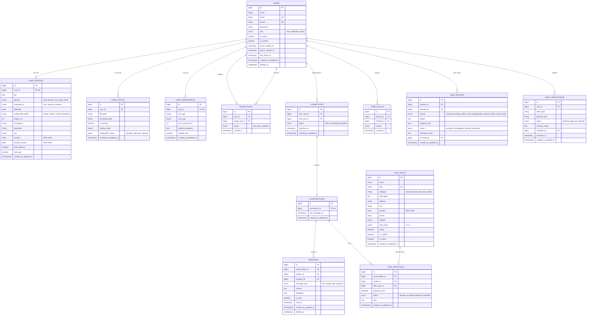

# Database Design & Schema Specification: LocalDateHub

**Author:** Principal Software Architect  
**Date:** November 2026  
**Status:** Approved Schema Blueprint  
**Target RDBMS:** MySQL 8.0+ / 8.4+ (InnoDB Engine)  
**Character Set & Collation:** `utf8mb4` / `utf8mb4_unicode_ci`

---

## 1. Database Architecture & Principles

The database schema for **LocalDateHub** is designed for high concurrent throughput, spatial GIS performance, strict relational integrity, and total location privacy.

### Key Database Standards
1. **Spatial Coordinates:** Spatial data is stored using the OpenGIS standard via MySQL `POINT` data types with `SRID 4326` (WGS 84 coordinate reference system). Spatial indexes (`SPATIAL INDEX`) are utilized for fast bounding-box queries.
2. **Compound Indexing for High-Speed Feeds:** Swipe cards, mutual match calculations, and chat histories utilize targeted composite indexes to avoid table scans.
3. **Data Anonymization & Soft Deletes:** Sensitive interactions support graceful soft-deletion, and user erasure triggers cascades to preserve data privacy according to GDPR standards.
4. **Relational Constraints:** Strict foreign keys with cascading deletions where appropriate (e.g., deleting a user cascades to profile, photos, and preferences; interactions and reports are preserved/anonymized for safety auditing).

---

## 2. Entity-Relationship Diagram (ERD)



---

## 3. Data Dictionary & Detailed Table Definitions

### 3.1 `users`
Core authentication and account status table.

| Column | Type | Constraints / Modifiers | Description |
| :--- | :--- | :--- | :--- |
| `id` | `BIGINT UNSIGNED` | `AUTO_INCREMENT, PRIMARY KEY` | Unique account identifier. |
| `name` | `VARCHAR(100)` | `NOT NULL` | Display name. |
| `email` | `VARCHAR(255)` | `NOT NULL, UNIQUE` | Normalized login email. |
| `phone` | `VARCHAR(30)` | `NULL, UNIQUE` | International format (+E.164) phone number. |
| `password` | `VARCHAR(255)` | `NOT NULL` | Argon2id / Bcrypt password hash. |
| `role` | `ENUM('user', 'moderator', 'admin')` | `DEFAULT 'user', NOT NULL` | Access tier. |
| `is_active` | `BOOLEAN` | `DEFAULT TRUE, NOT NULL` | Account suspension flag. |
| `is_verified` | `BOOLEAN` | `DEFAULT FALSE, NOT NULL` | Badge indicator for selfie verification. |
| `email_verified_at` | `TIMESTAMP` | `NULL` | Timestamp of email confirmation. |
| `phone_verified_at` | `TIMESTAMP` | `NULL` | Timestamp of OTP confirmation. |
| `last_active_at` | `TIMESTAMP` | `NULL, INDEX` | Presence and feed sorting freshness indicator. |
| `created_at` / `updated_at` | `TIMESTAMP` | `DEFAULT CURRENT_TIMESTAMP` | Standard auditing timestamps. |
| `deleted_at` | `TIMESTAMP` | `NULL` | Soft-delete timestamp. |

### 3.2 `user_profiles`
Detailed profile attributes, dating lifestyle, and spatial coordinates.

| Column | Type | Constraints / Modifiers | Description |
| :--- | :--- | :--- | :--- |
| `id` | `BIGINT UNSIGNED` | `AUTO_INCREMENT, PRIMARY KEY` | Profile identifier. |
| `user_id` | `BIGINT UNSIGNED` | `NOT NULL, UNIQUE, FK -> users.id (CASCADE)` | Associated user. |
| `bio` | `TEXT` | `NULL` | User personal statement (max 1000 chars). |
| `gender` | `ENUM('male', 'female', 'non_binary', 'other')` | `NOT NULL` | Gender identity. |
| `interested_in`| `ENUM('men', 'women', 'everyone')` | `NOT NULL` | Dating preference filter. |
| `birthdate` | `DATE` | `NOT NULL` | Used to compute real-time age (18+ enforced). |
| `relationship_intent` | `ENUM('dating', 'serious', 'casual', 'friendship')` | `NOT NULL` | Intent badge. |
| `height_cm` | `SMALLINT UNSIGNED` | `NULL` | Height in centimeters. |
| `occupation` | `VARCHAR(120)` | `NULL` | Job title or field. |
| `education` | `VARCHAR(120)` | `NULL` | College or degree. |
| `city` | `VARCHAR(100)` | `NOT NULL` | Locality name (e.g., "Austin, TX"). |
| `location` | `POINT` | `NOT NULL, SRID 4326, SPATIAL INDEX` | Internal precise GPS coordinates (Latitude, Longitude). |
| `location_fuzzed` | `POINT` | `NOT NULL, SRID 4326` | Obfuscated coordinates for radius calculations. |
| `hide_distance`| `BOOLEAN` | `DEFAULT FALSE` | Privacy toggle to suppress distance rendering. |
| `hide_age` | `BOOLEAN` | `DEFAULT FALSE` | Privacy toggle to suppress age display. |

### 3.3 `interactions`
High-volume interaction log powering swipe decks and matching.

| Column | Type | Constraints / Modifiers | Description |
| :--- | :--- | :--- | :--- |
| `id` | `BIGINT UNSIGNED` | `AUTO_INCREMENT, PRIMARY KEY` | Interaction identifier. |
| `user_id` | `BIGINT UNSIGNED` | `NOT NULL, FK -> users.id (CASCADE)` | User performing the action. |
| `target_user_id` | `BIGINT UNSIGNED` | `NOT NULL, FK -> users.id (CASCADE)` | User being evaluated. |
| `action` | `ENUM('like', 'pass', 'superlike')` | `NOT NULL` | Action taken. |
| `created_at` | `TIMESTAMP` | `DEFAULT CURRENT_TIMESTAMP, INDEX` | Timestamp of swipe. |

> **Key Index:** `UNIQUE INDEX uq_user_target (user_id, target_user_id)` ensures a user cannot swipe twice on the same candidate.  
> **Lookup Index:** `INDEX idx_target_action (target_user_id, action)` allows instant lookup for incoming likes during reciprocal match checks.

### 3.4 `connections` & `conversations`
Mutual match pairings and chat threads.

- **`connections`**:
  - `user_one_id` and `user_two_id` with check constraint `user_one_id < user_two_id` ensuring a single canonical representation of any matched pair.
  - Unique composite index `(user_one_id, user_two_id)`.
  - `status`: `ENUM('active', 'unmatched', 'blocked')`.
- **`conversations`**:
  - `connection_id` (Unique FK to `connections.id`).
  - `last_message_at` (Indexed for mailbox ordering).

### 3.5 `messages`
Real-time chat messages with encryption metadata.

| Column | Type | Constraints / Modifiers | Description |
| :--- | :--- | :--- | :--- |
| `id` | `BIGINT UNSIGNED` | `AUTO_INCREMENT, PRIMARY KEY` | Message identifier. |
| `conversation_id` | `BIGINT UNSIGNED` | `NOT NULL, FK -> conversations.id (CASCADE)` | Chat thread. |
| `sender_id` | `BIGINT UNSIGNED` | `NOT NULL, FK -> users.id (CASCADE)` | Author. |
| `recipient_id` | `BIGINT UNSIGNED` | `NOT NULL, FK -> users.id (CASCADE)` | Intended recipient. |
| `message_type` | `ENUM('text', 'image', 'date_proposal')` | `DEFAULT 'text', NOT NULL` | Type of payload. |
| `content` | `TEXT` | `NOT NULL` | Ciphertext or sanitized message body. |
| `metadata` | `JSON` | `NULL` | Dimensions, proposal ID, or thumbnail URL. |
| `is_read` | `BOOLEAN` | `DEFAULT FALSE, INDEX` | Read status. |
| `read_at` | `TIMESTAMP` | `NULL` | Receipt timestamp. |
| `created_at` | `TIMESTAMP` | `DEFAULT CURRENT_TIMESTAMP, INDEX` | Chronological sort index. |
| `deleted_at` | `TIMESTAMP` | `NULL` | Soft-delete flag (per user or global). |

### 3.6 `date_spots`
Curated venue directory for safe in-person meetups.

| Column | Type | Constraints / Modifiers | Description |
| :--- | :--- | :--- | :--- |
| `id` | `BIGINT UNSIGNED` | `AUTO_INCREMENT, PRIMARY KEY` | Spot identifier. |
| `name` | `VARCHAR(150)` | `NOT NULL` | Venue name. |
| `slug` | `VARCHAR(180)` | `NOT NULL, UNIQUE` | SEO-friendly URL slug. |
| `category` | `VARCHAR(50)` | `NOT NULL, INDEX` | e.g., 'cafe', 'rooftop', 'cocktail_bar', 'museum'. |
| `description` | `TEXT` | `NULL` | Ambience, best time to visit, vibe. |
| `address` | `VARCHAR(255)` | `NOT NULL` | Street address. |
| `city` | `VARCHAR(100)` | `NOT NULL, INDEX` | City. |
| `location` | `POINT` | `NOT NULL, SRID 4326, SPATIAL INDEX` | Venue GIS coordinates. |
| `price_level` | `TINYINT UNSIGNED`| `DEFAULT 2` | 1 ($), 2 ($$), 3 ($$$), 4 ($$$$). |
| `rating` | `DECIMAL(3, 2)` | `DEFAULT 5.00` | Community rating. |
| `is_verified` | `BOOLEAN` | `DEFAULT TRUE` | Platform-approved safe spot. |
| `is_active` | `BOOLEAN` | `DEFAULT TRUE` | Operating status. |

---

## 4. Indexing & Query Optimization Strategy

1. **Nearby Profile Query (GIS Spatial Bounding + Spherical Filtering):**
   ```sql
   -- Step 1: Rapid Bounding Box Filter via Spatial Index
   -- Step 2: Exact Distance Calculation with Distance Filter
   SELECT 
       u.id, 
       up.city, 
       ROUND(ST_Distance_Sphere(up.location_fuzzed, ST_GeomFromText('POINT(lon lat)', 4326)) / 1000, 1) AS distance_km
   FROM users u
   JOIN user_profiles up ON u.id = up.user_id
   WHERE u.is_active = TRUE
     AND u.id NOT IN (SELECT target_user_id FROM interactions WHERE user_id = :current_user_id)
     AND u.id NOT IN (SELECT blocked_id FROM user_blocks WHERE blocker_id = :current_user_id)
     AND ST_Distance_Sphere(up.location_fuzzed, ST_GeomFromText('POINT(lon lat)', 4326)) <= :max_distance_meters
   ORDER BY u.last_active_at DESC
   LIMIT 30;
   ```

2. **Mutual Match Detection (Atomic Evaluation):**
   ```sql
   -- Fast index check on reciprocal like
   SELECT id FROM interactions 
   WHERE user_id = :target_user_id 
     AND target_user_id = :current_user_id 
     AND action IN ('like', 'superlike')
   LIMIT 1;
   ```

3. **Partitioning Roadmap:**
   - At high scale (> 10 million interactions), the `interactions` table will be partitioned by hash on `user_id` or by range on `created_at` (monthly partitions) to optimize storage engine indexing.

