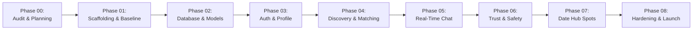

# Development Roadmap & Implementation Plan: LocalDateHub

**Author:** Principal Software Architect  
**Date:** November 2026  
**Status:** Approved Roadmap Specification  
**Version:** 1.0.0

---

## 1. Project Implementation Lifecycle

To ensure high architectural integrity, stability, and security, the implementation of **LocalDateHub** is organized into nine sequential phases. Each phase culminates in a clear quality gate before subsequent development commences.



---

## 2. Phased Milestone Overview

| Phase | Title | Core Deliverables | Quality Gate / Exit Criteria |
| :--- | :--- | :--- | :--- |
| **Phase 00** | Audit & Planning *(Current)* | Project audit, system architecture, database design, roadmap, security specification. | Complete documentation suite approved by stakeholders. |
| **Phase 01** | Scaffolding & Infrastructure | Git repository initialized, Laravel 11/12 installed, Livewire 3, Tailwind CSS, Vite, `.env.example`, Pest test runner. | Clean `git status`, successful `php artisan` bootstrap, Vite build passes with zero errors. |
| **Phase 02** | Database & Domain Models | Complete migrations (Spatial GIS), Eloquent models with custom casts, database factories, seeders with realistic demo profiles. | `php artisan migrate:fresh --seed` executes with zero warnings; spatial indexes validated. |
| **Phase 03** | Auth & Profile Builder | Registration, email/phone verification, multi-step profile builder, photo upload with EXIF sanitization, privacy toggles. | End-to-end registration and profile wizard pass automated feature tests. |
| **Phase 04** | Discovery & Matchmaking | Swiping deck (Livewire), geographic proximity queries, mutual match detection, match popup and notification. | Swipe performance < 100ms response; spatial bounding queries verified. |
| **Phase 05** | Real-Time Messaging | Laravel Reverb WebSocket setup, chat component, instant messaging, presence indicators, typing status. | Bi-directional messaging verified under concurrent WebSocket connections. |
| **Phase 06** | Trust, Safety & Moderation | Selfie verification workflow, 2-way instant blocking, user reporting system, administrative moderation dashboard. | Block test proves immediate visibility revocation; report escalation workflow confirmed. |
| **Phase 07** | Date Hub & Spot Discovery | Curated local venues directory, category filtering, "Propose Date" interactive chat attachments. | Spot discovery responds with distance sorting; date proposals render cleanly in chat. |
| **Phase 08** | QA, Hardening & Launch | Pest architecture tests, security scanning, rate limiting stress test, Redis caching verification, staging deployment. | 100% critical path test coverage, zero high/critical vulnerabilities on audit. |

---

## 3. Detailed Phase 01 Execution Plan

### 3.1 Objective
Establish the foundational codebase, initialize version control, install the modern Laravel framework, configure reactive frontend tooling, and establish environment configuration for the team.

### 3.2 Step-by-Step Action Items

#### Step 1: Version Control Initialization
- Execute `git init` in `/Volumes/EDGE/Localdatehub`.
- Establish standard branch structure (`main` as protected production baseline, `develop` as active integration branch).
- Author comprehensive `.gitignore` tailored for Laravel, Node, Vite, Composer, and macOS artifacts:
  - Ignore `/vendor`, `/node_modules`, `/public/build`, `/public/hot`, `.env`, `.DS_Store`, `*.log`, and storage directories.

#### Step 2: Framework Scaffolding
- Deploy Laravel 11.x/12.x skeleton into the repository.
- Structure application folders according to the Domain-Oriented Modular design defined in `docs/SYSTEM_ARCHITECTURE.md`:
  - `app/Domains/Identity`
  - `app/Domains/Geolocation`
  - `app/Domains/Matchmaking`
  - `app/Domains/Chat`
  - `app/Domains/DateSpots`
  - `app/Domains/Moderation`

#### Step 3: Core Dependency Installation
- **Composer Dependencies:**
  - Install Livewire 3: `composer require livewire/livewire`
  - Install Laravel Reverb: `composer require laravel/reverb`
  - Install Spatie Permission: `composer require spatie/laravel-permission`
  - Install Media & Image tools: `composer require intervention/image`
  - Install Pest testing framework: `composer require pestphp/pest --dev --with-all-dependencies`
- **NPM Dependencies:**
  - Install Tailwind CSS, `@tailwindcss/forms`, `@tailwindcss/typography`, `autoprefixer`, `postcss`, `alpinejs`, `laravel-echo`, `pusher-js`.

#### Step 4: Environment & Database Configuration
- Configure `.env.example` with:
  - `APP_NAME="LocalDateHub"`
  - `DB_CONNECTION=mysql`
  - `DB_HOST=127.0.0.1`
  - `DB_PORT=3306`
  - `DB_DATABASE=localdatehub`
  - `DB_USERNAME=root`
  - `BROADCAST_CONNECTION=reverb`
  - `QUEUE_CONNECTION=redis`
  - `CACHE_STORE=redis`
- Provide developer scripts to check MySQL socket availability and create the database schema.

#### Step 5: Frontend Tooling & Asset Compilation
- Configure `vite.config.js` with `laravel-vite-plugin` and Livewire reload support.
- Set up `resources/css/app.css` with `@tailwind base; @tailwind components; @tailwind utilities;`.
- Set up `resources/js/app.js` with Alpine.js and Laravel Echo initialization.
- Execute `npm run build` to verify frontend compilation pipeline.

#### Step 6: Initial Commit & Baseline Verification
- Run test runner (`./vendor/bin/pest` or `php artisan test`) to confirm framework baseline.
- Commit all Phase 01 baseline files with conventional commit message:
  ```text
  feat(core): initialize LocalDateHub scaffolding, Laravel foundation, and toolchains
  ```

### 3.3 Verification & Quality Gate Checklist
- [ ] `git status` shows clean tracking branch.
- [ ] `php artisan --version` returns valid modern Laravel version.
- [ ] `php artisan list` displays Livewire and Reverb commands.
- [ ] `npm run build` generates production assets into `public/build/` without warnings.
- [ ] Initial test suite runs and passes green.

