# Dynamic Personal Category Engine Specification & Operator Guide

**Platform:** LocalAdZone / LocalDateHub  
**Module:** `App\Modules\Categories`  
**Architecture:** Enterprise-grade Modular Monolith  
**Version:** 1.0.0 (Phase 05)  
**Status:** Production-Ready & Tested  

---

## 1. Executive Architecture Overview

The **Dynamic Personal Category Engine** powers all lawful adult personal classified listings and dating connections across LocalAdZone. The system is designed to be completely configurable via administrative controls without requiring code deployments or database schema alterations when introducing new connection types or attributes.

```mermaid
flowchart TD
    Root["Root Category (Depth 0)\nPersonals [PERS]"] --> G1["Group (Depth 1)\nMen Seeking [M_SEEK]"]
    Root --> G2["Group (Depth 1)\nWomen Seeking [W_SEEK]"]
    Root --> G3["Group (Depth 1)\nCouples Seeking [C_SEEK]"]
    Root --> G4["Group (Depth 1)\nLGBTQ+ Personal Connections [LGBTQ]"]
    Root --> G5["Group (Depth 1)\nGeneral Personal Connections [GEN_CONN]"]

    G1 --> S1["Subcategory (Depth 2)\nMen Seeking Women [M4W]"]
    G1 --> S2["Subcategory (Depth 2)\nMen Seeking Men [M4M]"]
    G1 --> S3["Subcategory (Depth 2)\nMen Seeking Couples [M4C]"]

    G2 --> S4["Subcategory (Depth 2)\nWomen Seeking Men [W4M]"]
    G2 --> S5["Subcategory (Depth 2)\nWomen Seeking Women [W4W]"]
    G2 --> S6["Subcategory (Depth 2)\nWomen Seeking Couples [W4C]"]

    G3 --> S7["Subcategory (Depth 2)\nCouples Seeking Women [C4W]"]
    G3 --> S8["Subcategory (Depth 2)\nCouples Seeking Men [C4M]"]
    G3 --> S9["Subcategory (Depth 2)\nCouples Seeking Couples [C4C]"]

    G4 --> S10["Subcategory (Depth 2)\nNon-Binary & Trans [TGNC]"]
    G4 --> S11["Subcategory (Depth 2)\nQueer Singles & Dating [QUEER]"]

    G5 --> S12["Subcategory (Depth 2)\nActivity Partners [ACT]"]
    G5 --> S13["Subcategory (Depth 2)\nLong-Term Dating [LTR]"]
    G5 --> S14["Subcategory (Depth 2)\nCasual Dating [CSL]"]
    G5 --> S15["Subcategory (Depth 2)\nFriendship [FRN]"]
```

---

## 2. Core Architectural Principles

1. **Unlimited Configurable Depth with Safe Upper Bounds (`MAX_DEPTH = 5`):**
   - Eliminates hardcoded categories from frontend templates and business logic.
   - Enforces strict upper bound checks to prevent runaway recursion or UI tree nesting breakdown.
   - Cycle prevention prevents a category from being its own parent or choosing any of its recursive descendants as a parent.
2. **Dynamic Listing Attributes Engine:**
   - Supports 8 field types: `text`, `textarea`, `number`, `select`, `multiselect`, `radio`, `boolean`, and `range`.
   - **Attribute Inheritance:** Leaf subcategories inherit both global attributes (`category_id = null`) and ancestor attributes in addition to local category attributes.
   - Dynamic validation engine (`CategoryService::validateListingAttributes`) dynamically compiles Laravel validation rules on the fly.
3. **Safe Category Deletion with Reassignment Checks:**
   - Direct deletion is blocked if active listings exist.
   - Administrative reassignments migrate listings from source to destination category in an atomic database transaction and log audit status history records (`ListingStatusHistory`).
4. **Admin Preview Capabilities:**
   - Disabled/draft categories return HTTP 404 to public visitors.
   - Authenticated administrators can preview inactive categories (`/admin/categories/{category}/preview`) with full public rendering and an informative preview ribbon.

---

## 3. Database Schema Overview

### `categories` Table
| Column | Type | Description |
|---|---|---|
| `id` | `BIGINT UNSIGNED` | Primary Key |
| `parent_id` | `BIGINT UNSIGNED NULL` | Self-referencing Foreign Key (`categories.id`) |
| `depth` | `TINYINT UNSIGNED` | Hierarchy depth level (0 = Root, 1 = Group, 2 = Subcategory) |
| `name` | `VARCHAR(100)` | Public display name |
| `slug` | `VARCHAR(120)` | Unique URL slug |
| `code` | `VARCHAR(20) NULL` | Short code (e.g., `M4W`, `W4M`, `ACT`, `LGBTQ`) |
| `description` | `TEXT NULL` | Category description |
| `safety_guidelines` | `TEXT NULL` | Compliance and trust/safety notice displayed to posters and visitors |
| `icon` | `VARCHAR(50)` | Icon identifier (default: `heart`) |
| `min_age_override` | `SMALLINT UNSIGNED NULL` | Custom age threshold override (e.g., 21 in specific jurisdictions) |
| `display_order` | `INT UNSIGNED` | Manual sort ordering |
| `is_active` | `BOOLEAN` | Public visibility toggle |
| `is_featured` | `BOOLEAN` | Highlighted badge toggle |
| `allowed_contact_methods` | `JSON NULL` | Allowed contact channels (`platform_message`, `email_relay`, `phone`) |
| `seo_metadata` | `JSON NULL` | Meta title, description, and keywords |

### `category_attributes` Table
| Column | Type | Description |
|---|---|---|
| `id` | `BIGINT UNSIGNED` | Primary Key |
| `category_id` | `BIGINT UNSIGNED NULL` | Target Category (`null` = Global across all categories) |
| `name` | `VARCHAR(100)` | Public attribute label |
| `code` | `VARCHAR(50)` | Machine identifier (e.g. `intent`, `height_inches`, `smoking`) |
| `field_type` | `VARCHAR(30)` | Dynamic input type |
| `placeholder` | `VARCHAR(150) NULL` | Input placeholder text |
| `help_text` | `VARCHAR(255) NULL` | Helper prompt text |
| `unit` | `VARCHAR(30) NULL` | Measurement unit (e.g. `inches`, `lbs`, `years`) |
| `is_required` | `BOOLEAN` | Mandatory input enforcement |
| `is_searchable` | `BOOLEAN` | Included in search index |
| `is_filterable` | `BOOLEAN` | Included in category landing page filter pills |
| `display_order` | `INT UNSIGNED` | Sort order |

### `category_attribute_options` Table
| Column | Type | Description |
|---|---|---|
| `id` | `BIGINT UNSIGNED` | Primary Key |
| `category_attribute_id` | `BIGINT UNSIGNED` | Foreign key referencing `category_attributes.id` |
| `label` | `VARCHAR(100)` | Human-readable label (e.g. `Non-smoker`) |
| `value` | `VARCHAR(100)` | Stored value string (e.g. `non_smoker`) |
| `display_order` | `INT UNSIGNED` | Option sort order |

---

## 4. Web & API Endpoints

### Public Web Routes
- `GET /categories`: Directory of all root categories, groups, subcategories, and active listing counts.
- `GET /categories/{slug}`: Category landing page featuring child categories, dynamic attribute filters, safety notice, and listings.

### Administrative Control Routes (`auth` + `admin`/`super_admin`)
- `GET /admin/categories`: Hierarchical tree table with depth indentation, status toggles, and actions.
- `GET /admin/categories/create`: Form to create root or child category.
- `POST /admin/categories`: Create category action with slug auto-generation.
- `GET /admin/categories/{category}/edit`: Form to update category details.
- `PUT /admin/categories/{category}`: Update category action.
- `DELETE /admin/categories/{category}`: Safe delete with dependency check.
- `GET /admin/categories/{category}/preview`: Administrator preview mode for draft/disabled categories.
- `GET /admin/categories/{category}/reassign`: UI to migrate listings from one category to another.
- `POST /admin/categories/{category}/reassign`: Execute listing migration.
- `GET /admin/categories/{category}/attributes`: Dynamic attribute builder.
- `POST /admin/categories/{category}/attributes`: Add dynamic attribute.
- `DELETE /admin/categories/attributes/{attribute}`: Remove attribute.
- `POST /admin/categories/attributes/{attribute}/options`: Add dropdown/radio option.
- `DELETE /admin/categories/attributes/options/{option}`: Remove option.

### REST API Endpoints
- `GET /api/v1/categories/tree`: Full hierarchical JSON tree with nested subcategories.
- `GET /api/v1/categories/{slug}`: Category details by slug or ID.
- `GET /api/v1/categories/{category}/attributes`: Applicable dynamic attributes, validation rules, and options for listing wizard integration.

---

## 5. Verification & Testing Evidence

Automated tests in `tests/Feature/CategoryEngineTest.php`:
1. `test_category_tree_hierarchy_and_depth`: **PASS**
2. `test_maximum_depth_enforcement_prevents_runaway_recursion`: **PASS**
3. `test_category_cannot_be_its_own_parent_or_descendant`: **PASS**
4. `test_category_slug_uniqueness_and_auto_increment`: **PASS**
5. `test_dynamic_attributes_and_inheritance`: **PASS**
6. `test_attribute_validation_engine`: **PASS**
7. `test_category_reassignment_service_migrates_listings`: **PASS**
8. `test_safe_deletion_dependency_checks`: **PASS**
9. `test_public_category_directory_and_landing_pages`: **PASS**
10. `test_admin_preview_mode_allows_viewing_disabled_categories`: **PASS**
11. `test_admin_category_management_routes_require_authorization`: **PASS**
12. `test_category_api_endpoints_return_json_tree_and_attributes`: **PASS**
13. `test_livewire_category_filter_component`: **PASS**

Total Project Suite: **65 passing tests, 417 assertions, 0 errors, 0 failures.**
