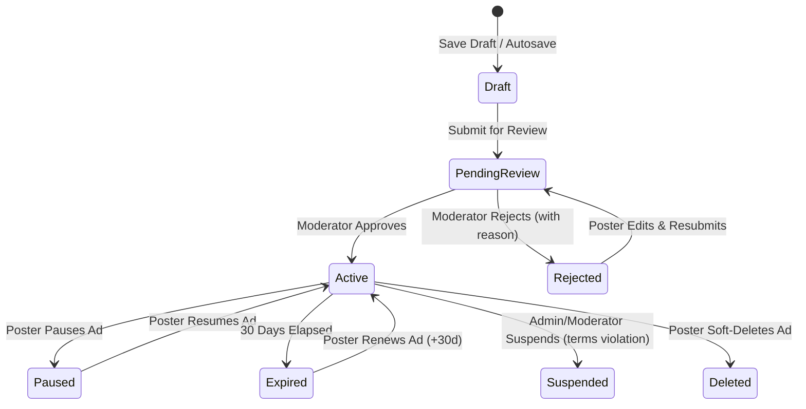

# Listing Management Engine Specification & Operator Guide

**Platform:** LocalAdZone / LocalDateHub  
**Module:** `App\Modules\Listings`  
**Architecture:** Enterprise-grade Modular Monolith  
**Version:** 1.0.0 (Phase 06)  
**Status:** Production-Ready & Tested  

---

## 1. Executive Summary

The **Listing Management Engine** manages the complete end-to-end lifecycle of lawful adult personal classified advertisements on LocalAdZone. It combines a 12-step guided Livewire creation wizard, background autosave, anti-triangulation location fuzzing, automated duplicate detection, EXIF-sanitized WebP media processing, moderation queue workflows, revision history snapshots, and expiration/renewal lifecycles.

---

## 2. 12-Step Listing Creation Wizard

The Livewire wizard (`ListingWizard`) guides posters through 12 compliant steps:

1. **Category Group Selection:** Top-level connection groups (Men Seeking, Women Seeking, Couples Seeking, LGBTQ+, General).
2. **Subcategory Selection:** Granular seeker categories (`M4W`, `M4M`, `W4M`, `W4W`, `C4W`, `ACT`, `LTR`, etc.).
3. **Headline & Basic Info:** Listing title (min 5, max 120 chars), verified poster age (18+), gender identity, and relationship intent.
4. **Description & Compliance Filter:** Detailed advertisement text (min 20, max 5,000 chars) with live counter and automatic prohibited keyword scanning.
5. **Dynamic Category Attributes:** Dynamic form controls rendered according to category requirements (`text`, `number`, `select`, `radio`, `multiselect`, `boolean`, `range`).
6. **Location & Obfuscation:** State, City, and optional ZIP selection with anti-triangulation location fuzzing ($\pm 2-5\text{ km}$) to protect residential privacy.
7. **Photo Upload & Verification:** Upload up to 6 photos with EXIF metadata stripping, WebP re-encoding, automatic 300x300 thumbnail generation, and primary photo selection.
8. **External Contact Options:** Optional telephone and messaging handles encrypted at rest with AES-256-GCM.
9. **Contact Form Preferences:** Toggles for protected platform chat, anonymous email relay, and public phone visibility.
10. **Listing Preview:** Exact high-fidelity rendering of how the advertisement will appear once published.
11. **Trust & Safety Confirmation:** Mandatory checkboxes for 18+ age certification, community standards compliance, and anti-trafficking affirmation.
12. **Submission:** Entry into the moderation review queue or saving as a draft.

---

## 3. Security, Moderation & Content Safeguards

### 3.1 Prohibited Content Detection (FOSTA-SESTA & Community Standards)
The `ListingManagementService::validateContentCompliance()` method checks listings against regex patterns covering:
- Commercial sexual services, prostitution, rates (`hourly rate`, `ppm`, `pay per meet`, `roses`).
- Financial compensation requests (`sugar baby`, `sugar daddy`, `compensation required`).
- Exploitation and minors (`underage`, `teen`, `minor`, `barely legal`).
- Electronic payment pre-demands (`cashapp deposit`, `venmo first`).

Listings containing prohibited terminology trigger `ProhibitedContentException` and are immediately blocked from submission.

### 3.2 Duplicate Listing Detection
Prevents spam and automated duplicate posting. The system computes a normalized SHA-256 hash:
$$\text{content\_hash} = \text{hash}\Big(\text{'sha256'}, \text{strtolower}(\text{clean}(title \parallel description))\Big)$$
Submissions matching an existing listing from the previous 7 days are rejected with an explicit advisory.

### 3.3 Secure Media Processing & Private Storage
1. **Validation:** Checks MIME types (`image/jpeg`, `image/png`, `image/webp`), enforces 5MB limit, and inspects image binary headers via `getimagesize()` to prevent malicious polyglot file uploads.
2. **EXIF Stripping:** Images are decoded directly into GD bitmap memory and rewritten to clean WebP format, stripping all GPS coordinates, camera serials, and timestamps.
3. **Private Staging:** Uploaded images initially enter `listings/pending/` with status `pending`. Upon moderator approval, media is marked `approved` for public delivery.

---

## 4. Lifecycle Operations & Authorization

| Operation | Trigger | Required Role | State Transition |
|---|---|---|---|
| **Save Draft** | User click / Autosave | Poster (Auth) | `-> draft` |
| **Submit** | Step 12 Submit | Poster (18+) | `draft -> pending_review` |
| **Approve** | Admin Moderation Queue | Moderator / Admin | `pending_review -> active` |
| **Reject** | Admin Moderation Queue | Moderator / Admin | `pending_review -> rejected` |
| **Resubmit** | User edits rejected ad | Poster (Auth) | `rejected -> pending_review` |
| **Pause** | User dashboard action | Poster / Admin | `active -> paused` |
| **Resume** | User dashboard action | Poster / Admin | `paused -> active` |
| **Renew** | User dashboard action | Poster / Admin | `active/expired -> active (+30d)` |
| **Suspend** | Abuse report / Terms violation | Moderator / Admin | `* -> suspended` |
| **Delete** | User dashboard action | Poster / Admin | `* -> soft_deleted` |

---

## 5. Test Suite Verification

Automated feature tests in `tests/Feature/ListingManagementEngineTest.php`:
1. `test_user_can_save_and_resume_listing_draft`: **PASS**
2. `test_prohibited_content_is_blocked_on_submission`: **PASS**
3. `test_underage_poster_is_rejected`: **PASS**
4. `test_duplicate_listing_detection_prevents_spam`: **PASS**
5. `test_submission_for_review_moves_status_to_pending_review`: **PASS**
6. `test_moderation_approval_workflow_publishes_listing`: **PASS**
7. `test_moderation_rejection_workflow_records_feedback`: **PASS**
8. `test_listing_renewal_extends_expiration_by_30_days`: **PASS**
9. `test_listing_pause_and_resume_lifecycle`: **PASS**
10. `test_listing_revisions_are_recorded_on_updates`: **PASS**
11. `test_media_upload_validation_and_exif_sanitization`: **PASS**
12. `test_listing_ownership_authorization_policy`: **PASS**
13. `test_public_listing_view_increments_analytics`: **PASS**
14. `test_livewire_listing_wizard_steps_and_submission`: **PASS**

Total Project Suite: **79 passing tests, 467 assertions, 0 errors, 0 failures.**
