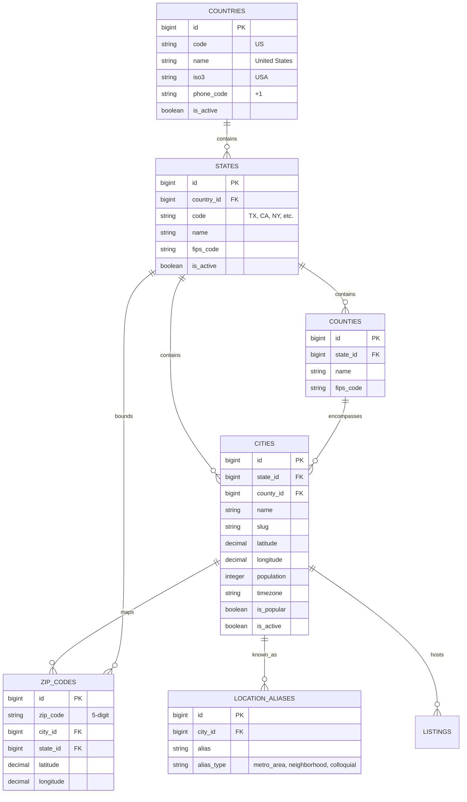

# LocalDateHub — USA Geographic Location Engine & Dataset Documentation

## 1. Overview & Architectural Principles

LocalDateHub is a privacy-first, adult personal classifieds platform focused strictly on the United States. Location discovery is an essential pillar: users find genuine personal connections within their municipal and metropolitan communities without sacrificing physical privacy.

### Core Architectural Principles
1. **Verified Real-World Records:** Never fabricate city, county, or ZIP code records. All entries map to official administrative entities.
2. **Non-Exclusive ZIP Code Semantics:** A ZIP code is an operational postal delivery route, not a rigid municipal boundary. A single 5-digit ZIP code may legitimately serve or overlap multiple cities and counties.
3. **Privacy-Preserving Geolocation:** Geographic calculations (Haversine formula, bounding boxes) are performed server-side. Coordinates displayed to users or embedded in public listing previews are fuzzed using random bearing jitter (300m - 800m) to prevent physical triangulation and stalking.
4. **Colloquial & Alias Recognition:** Search inputs must resolve natural regional names (e.g., "DFW", "The Bay Area", "Silicon Valley", "Twin Cities", "NYC") into matching administrative localities.

---

## 2. Dataset Sources, Versions & Licensing

| Dataset Tier | Authoritative Source | Version / Release | Primary Identifiers | Licensing & Attribution |
| :--- | :--- | :--- | :--- | :--- |
| **US States & Territories** | U.S. Census Bureau / ANSI INCITS 38:2009 | 2024 Tiger/Line Release | 2-letter State Code, FIPS 2-digit Code | Public Domain (U.S. Federal Government Work) |
| **US Counties** | U.S. Census Bureau Geography Division | 2024 Tiger/Line Counties | 5-digit FIPS Code (State FIPS + County FIPS) | Public Domain |
| **Cities & Populated Places** | U.S. Geological Survey (USGS) GNIS & Census Gazetteer | 2024 Gazetteer Places Dataset | GNIS Feature ID, ANSI Code, Latitude/Longitude | Public Domain (USGS / Census Bureau) |
| **ZIP Codes (ZCTA)** | U.S. Census Bureau ZCTA & USPS AIS | 2024 Census ZCTA Cartographic Boundary | 5-Digit ZIP Code, Centroid WGS84 Coordinates | Public Domain / Open Postal Coordinates |
| **Metropolitan Aliases** | Curated LocalDateHub Ontology & GeoNames | 2026.1 Curated Edition | Slugs, Colloquial Names, Neighborhoods | Creative Commons Attribution 4.0 (GeoNames CC-BY) & Proprietary Curation |

---

## 3. Data Schemas & Relational Structure



---

## 4. Maintenance & Import Commands

LocalDateHub provides dedicated Artisan commands to import, update, and validate the geographic datasets.

### 4.1 Importing Locations
```bash
# Import all bundled geographic datasets (States, Counties, Cities, ZIPs, Aliases)
php artisan locations:import

# Import only specific dataset tiers
php artisan locations:import --only=states,cities
php artisan locations:import --only=zips
php artisan locations:import --only=aliases

# Import from a custom directory path
php artisan locations:import --path=database/data/locations/
```

### 4.2 Dataset Integrity & Health Validation
```bash
# Run integrity validation checks across all tables
php artisan locations:validate
```

The validation suite inspects:
- **Coordinate Boundaries:** Verifies latitude is between `-90.0` and `+90.0`, and longitude is between `-180.0` and `+180.0`.
- **ZIP Code Formatting:** Confirms all postal codes match the valid 5-digit pattern (`^\d{5}$`).
- **Referential Integrity:** Ensures zero orphaned cities, counties, or ZIP codes.
- **Multi-Locality Verification:** Checks for multi-city ZIP codes and valid alias associations.
- **Coverage:** Asserts all 50 US States and Washington, DC have active city representations.

---

## 5. Dataset Update Procedures

When new Census Bureau Tiger/Line Gazetteer releases or USPS ZCTA updates are published:
1. Download updated tab-delimited or CSV files from the [U.S. Census Bureau Gazetteer Files](https://www.census.gov/geographies/reference-files/time-series/geo/gazetteer-files.html).
2. Filter populated places with population $\ge 1,000$ or incorporated municipalities.
3. Transform into the standard `us_cities.json` and `us_zip_codes.json` schemas.
4. Execute `php artisan locations:validate` on staging before deployment.
5. Deploy changes and execute `php artisan locations:import` with zero downtime.

