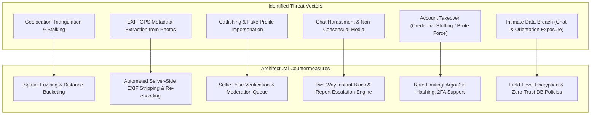

# Security & Compliance Specification: LocalDateHub

**Author:** Principal Software Architect  
**Date:** November 2026  
**Status:** Approved Security Specification  
**Version:** 1.0.0

---

## 1. Domain Threat Model for Dating & Social Platforms

Dating and geolocation platforms possess an exceptionally sensitive threat profile. Users entrust the platform with intimate personal data, real-time geographic proximity, private photos, and personal conversations. The architecture must defend against both traditional cyber threats and physical safety threats.

---

## 2. Security Architecture & Technical Safeguards

### 2.1 Geolocation Privacy & Anti-Triangulation Engine
- **Vulnerability:** If an attacker can measure distances to a target user from three arbitrary coordinates, they can execute multilateration to pinpoint the target's exact home or work address.
- **Enforced Architectural Countermeasure:**
  1. **Strict Spatial Separation:** Precise latitude and longitude are never returned in JSON responses, API payloads, or Blade views.
  2. **Coordinate Fuzzing:** The database calculates distances using a server-side fuzzing algorithm that offsets the stored coordinate randomly within a 300–800 meter jitter radius per query session.
  3. **Distance Bucketing:** The user interface renders only coarse distance bands:
     - Under 1 km: Displayed as `"Less than a kilometer away"`.
     - 1 km to 10 km: Displayed in whole integers (e.g., `"~3 km away"`).
     - Privacy Toggle: Users can enable `"Hide My Exact Distance"` in settings, displaying only their city name.

### 2.2 Secure Media Pipeline & EXIF Metadata Elimination
- **Vulnerability:** Photos taken on smartphones contain Exchangeable Image File Format (EXIF) metadata, including exact GPS coordinates, altitude, timestamp, and device serial numbers.
- **Enforced Architectural Countermeasure:**
  1. **MIME-Type & Header Validation:** Uploads are verified via magic byte inspection (`finfo_file`), rejecting masqueraded executable payloads. Allowed MIME types: `image/jpeg`, `image/png`, `image/webp`.
  2. **Immediate Re-encoding:** Uploaded image streams are piped through Intervention Image / GD to create completely new `.webp` bitmaps.
  3. **Zero EXIF Retention:** All metadata headers, GPS tags, and camera specifications are stripped during the re-encoding pass before the asset is saved to disk or object storage.
  4. **Strict Size Limits:** Enforce maximum upload size of 8 MB per image; resized to maximum dimension `1600x1600` px.

### 2.3 Authentication, Session & Access Security
1. **Password Storage:** Modern Argon2id hashing with memory cost `65536`, time cost `4`, and parallelism `1`.
2. **Session Protection:**
   - Session cookies configured with `HttpOnly`, `SameSite=Lax`, and `Secure` (HTTPS only).
   - Session regeneration on login, privilege elevation, and password change to prevent session fixation.
3. **Throttling & Rate Limiting:**
   - Auth endpoints: Max 5 failed attempts per minute per IP before temporary lockout.
   - Swipe actions: Max 60 swipes per minute to neutralize automated bot scrapers.
   - Messaging: Max 20 messages per minute per user.
4. **Role-Based Access Control (RBAC):**
   - Three discrete tiers: `user`, `moderator`, `admin`.
   - Admin routes guarded by dedicated `auth:sanctum` or session middleware, with mandatory 2FA.

### 2.4 Chat Security & Private Communications
- **In-Transit Encryption:** Enforced TLS 1.3 across all HTTPS and WSS (WebSocket) traffic.
- **Database Storage:** Message contents are stored with field-level encryption (`casts => ['content' => 'encrypted']`) in MySQL to protect user privacy against offline database dumps.
- **Ephemeral Message Support:** Soft-delete mechanisms allow users to revoke messages or delete complete conversation threads.

---

## 3. Trust, Safety & Community Standards

### 3.1 Two-Way Instant Blocking
- When user $A$ blocks user $B$:
  - The block takes immediate effect with zero notification to user $B$.
  - All existing matches and active conversations are instantly hidden.
  - Neither user will ever appear in the other's discovery deck or search queries again.
  - Active WebSocket communication channels between the pair are revoked immediately.

### 3.2 Reporting & Investigation Workflow
- Users can file structured reports with category tags (`Harassment`, `Impersonation`, `Scam`, `Inappropriate Content`, `Safety`).
- The report captures a snapshot of recent messages, profile photos, and timestamps as tamper-evident evidence.
- An administrative moderation portal allows reviewers to take action:
  - **Dismiss:** With auditing notes.
  - **Warn:** In-app policy notice.
  - **Shadowban:** Profile excluded from discovery feeds without alerting bad actor.
  - **Hard Ban:** Immediate account deactivation, session termination, and phone/email blacklisting.

### 3.3 Selfie Verification Protocol
- To combat catfishing and AI-generated bots, users can request a "Verified Profile" badge.
- The user is prompted to submit a photo replicating a randomized, dynamic gesture (e.g., peace sign, three fingers raised).
- Photos are evaluated in a secure moderator queue or via biometric comparison before the `is_verified` flag is set.

---

## 4. Compliance & Regulatory Standards

### 4.1 Strict Age Verification (18+ Enforcement)
- LocalDateHub strictly prohibits minors.
- **Enforcement:**
  - Date of birth input required during registration.
  - Server-side validation rejects any birthdate indicating an age under 18 years at the time of submission.
  - Once verified, the date of birth cannot be modified by the user without moderator intervention.

### 4.2 GDPR & CCPA Compliance
1. **Right to Access (Data Portability):**
   - Self-service feature enabling users to request a complete machine-readable JSON archive of their profile data, match history, and sent messages.
2. **Right to be Forgotten (Account Deletion):**
   - Initiating account deletion triggers a graceful cascade:
     - Profile, preferences, and photos are permanently unlinked and purged from disk/cloud storage.
     - Ongoing conversations are marked as "Deleted User".
     - Sensitive PII (email, phone, IP history) is permanently scrubbed after a 30-day safety hold (retained solely for compliance and active harassment investigations).
3. **Explicit Consent & Granular Privacy:**
   - Clear opt-in consent for geolocation services.
   - Privacy settings allowing users to hide their online status, distance, or age from the public feed.

---

## 5. Security Checklist & Audit Verification Matrix

| Area | Security Standard | Verification Method |
| :--- | :--- | :--- |
| **Geolocation** | Coordinates never exposed in frontend responses | Automated API contract tests assert latitude/longitude keys are absent. |
| **Uploads** | Zero EXIF metadata in saved media | Automated Pest test uploads photo with GPS EXIF; asserts output has empty EXIF. |
| **Passwords** | Argon2id hashing algorithm enforced | Configuration test checks `config('hashing.driver') === 'argon2id'`. |
| **Headers** | HSTS, X-Frame-Options, CSP, X-Content-Type-Options | Security header middleware verified via HTTP integration tests. |
| **Bot Defense** | Rate limiting active on auth & swipe endpoints | HTTP tests simulate 100 requests; assert `429 Too Many Requests` returned. |
| **Database** | Field-level encryption on message content | Direct SQL query verifies raw table column contains ciphertext string. |

