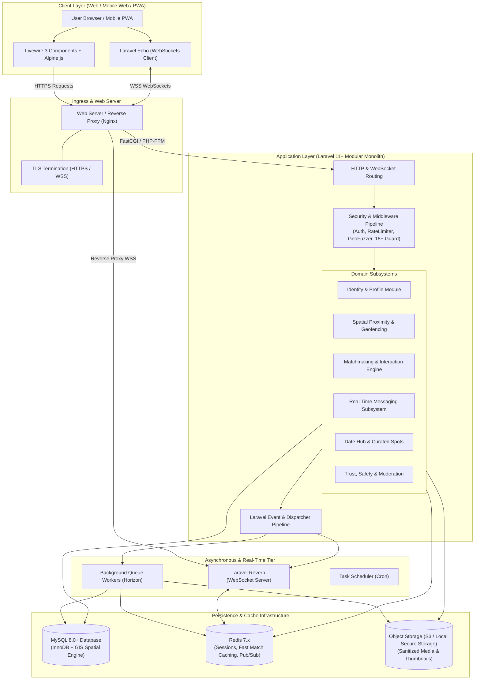
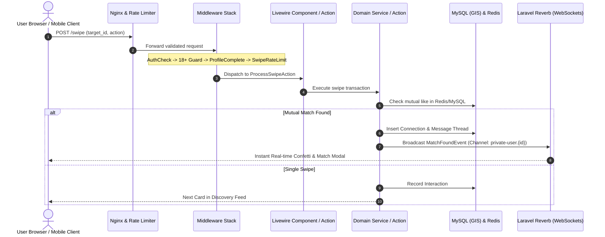

# System Architecture: LocalDateHub

**Author:** Principal Software Architect  
**Date:** November 2026  
**Status:** Approved Architectural Specification  
**Version:** 1.0.0

---

## 1. Architectural Vision & Core Principles

**LocalDateHub** is engineered as a high-performance, privacy-centric local dating and social connection platform. The system facilitates meaningful real-world connections by combining:
1. **Frictionless Proximity Discovery:** Finding potential partners nearby without compromising exact location privacy.
2. **Instant Bidirectional Matchmaking:** High-throughput swipe and interaction processing.
3. **Low-Latency Encrypted Chat:** Real-time messaging with typing indicators, presence tracking, and media exchange.
4. **Trust & Verification:** Automated photo EXIF sanitization, facial verification workflows, and proactive reporting.
5. **Local Date Hub Directory:** Integrated curated local date spots, cafes, and activities to bridge digital matches into safe physical dates.

### Architectural Principles
- **Privacy by Design:** Exact coordinates (lat/long) are never transmitted to client browsers or mobile devices; obfuscation and distance bucketing occur on the server.
- **Reactive & Real-Time:** Utilizing Laravel Livewire 3 and Laravel Reverb WebSockets for a single-page-app (SPA) feel without the overhead of disparate frontend/backend repositories.
- **Modular Monolith:** Domain logic is partitioned into cohesive modules (Identity, Discovery, Matchmaking, Messaging, DateSpots, Moderation) within a unified codebase for high developer velocity and straightforward deployments.
- **Fail-Safe Asynchronous Processing:** Resource-heavy tasks (EXIF stripping, image optimization, push notifications, distance calculations for thousands of users) are handled asynchronously via Redis-backed queue workers.

---

## 2. System Architecture Diagram



---

## 3. Subsystem Breakdown & Component Responsibilities

### 3.1 Identity & Profile Subsystem (`App\Domains\Identity`)
- **User Authentication:** Multi-factor authentication, secure password hashing (Argon2id), phone/email verification.
- **Profile Customization:** Personal bios, lifestyle habits (smoking, drinking, exercise), relationship intent, height, zodiac, languages, and custom icebreakers.
- **Media Vault:** Multi-photo upload with order management, thumbnail generation (WebP), and verification selfie capture.
- **User Verification:** Biometric/gesture verification matching user selfies against profile photos.

### 3.2 Proximity & Geolocation Engine (`App\Domains\Geolocation`)
- **Spatial Coordinates:** Stored as MySQL `GEOMETRY POINT(latitude, longitude) SRID 4326`.
- **Proximity Calculations:** 
  - Rapid bounding-box pre-filtering via spatial indices (`MBRContains`).
  - High-precision distance calculation using `ST_Distance_Sphere(location, POINT(target_lon, target_lat))`.
- **Location Fuzzing Pipeline:** 
  - Prevents triangulation attacks.
  - Generates a randomized offset circle (radius 300m - 800m) or returns rounded distance brackets ("2 km away", "Within 5 km").
  - Absolute latitude and longitude are strictly isolated inside the database layer and never rendered in views or JSON models.

### 3.3 Discovery & Matchmaking Engine (`App\Domains\Matchmaking`)
- **Swipe & Interaction Processing:**
  - Actions: `LIKE`, `PASS`, `SUPERLIKE`.
  - Stored in high-throughput `interactions` table with Redis write-behind caching for high traffic.
- **Bidirectional Match State Machine:**
  - Upon user $A$ swiping `LIKE` on user $B$, system checks interaction cache/database for user $B$'s swipe on $A$.
  - If mutual: atomic transaction creates a `connections` record, triggers `MatchFoundEvent`, and initializes a real-time conversation.
- **Recommendation & Filtering Engine:**
  - Filters: Age range, maximum radius, gender preference, mutual interests, verification status, and activity freshness (`last_active_at`).
  - Excludes already swiped, blocked, or inactive profiles.

### 3.4 Real-Time Messaging & Chat (`App\Domains\Chat`)
- **Infrastructure:** Powered by **Laravel Reverb** (native, event-driven WebSocket server) paired with Redis Pub/Sub.
- **Message Features:**
  - 1-on-1 private messaging between matched connections.
  - End-to-Transit TLS encryption and database ciphertext storage for private chats.
  - Typing indicators (`whisper` events), online/offline presence indicators, and message delivery/read receipts (`read_at`).
  - Interactive "Date Proposal" message types linking directly to curated local spots.

### 3.5 Date Hub & Spot Discovery (`App\Domains\DateSpots`)
- **Venue Curation:** Searchable directory of romantic, casual, and safe first-date venues (cafes, rooftop bars, parks, activity centers).
- **Location Matching:** Queries venues geographically positioned equidistant or convenient to both matched users.
- **Interactive Invites:** Allows users to send an embedded "Let's meet here" invitation directly inside the chat interface.

### 3.6 Trust, Safety & Moderation (`App\Domains\Moderation`)
- **Automated EXIF Sanitization:** Every uploaded image is stripped of all EXIF/GPS metadata via server-side processing before persistence.
- **Blocking & Shadowbanning:** Two-way invisible blocking immediately terminates active chats, hides profiles from discovery, and prevents re-matching.
- **Reporting & Flagging:** Context-aware reporting flow (inappropriate messages, fake profiles, harassment, safety concerns). Escalates to an administrative moderation queue.

---

## 4. Layering & Architectural Pattern

LocalDateHub uses a Domain-Oriented Layered Architecture within Laravel:

```text
app/
├── Domains/
│   ├── Identity/
│   │   ├── Actions/            (e.g., RegisterUserAction, UpdateProfileAction)
│   │   ├── Models/             (User, UserProfile, UserPhoto)
│   │   ├── DTOs/               (ProfileData, UserRegistrationData)
│   │   └── Events/             (UserVerified, ProfileUpdated)
│   ├── Geolocation/
│   │   ├── Services/           (GeoProximityService, CoordinateFuzzer)
│   │   └── Scopes/             (NearbyScope)
│   ├── Matchmaking/
│   │   ├── Actions/            (ProcessSwipeAction, CreateConnectionAction)
│   │   ├── Models/             (Interaction, Connection)
│   │   └── Queries/            (DiscoveryFeedQuery)
│   ├── Chat/
│   │   ├── Actions/            (SendMessageAction, MarkAsReadAction)
│   │   ├── Models/             (Conversation, Message)
│   │   └── Events/             (MessageSent, TypingStatusChanged)
│   ├── DateSpots/
│   │   ├── Models/             (DateSpot, SpotReview)
│   │   └── Queries/            (NearbySpotsQuery)
│   └── Moderation/
│       ├── Actions/            (BlockUserAction, FileReportAction)
│       └── Models/             (UserBlock, UserReport)
├── Http/
│   ├── Controllers/            (Slim controllers delegating to Actions)
│   ├── Livewire/               (Interactive reactive UI components)
│   └── Middleware/             (EnsureProfileCompleted, PreventLocationExposure)
```

---

## 5. Request Lifecycle & Middleware Pipeline



---

## 6. Caching & Performance Strategy

1. **Discovery Feed Pre-computation:**
   - Active users' discovery queues are cached in Redis sorted sets by geographic proximity and activity score, avoiding heavy spatial queries on every card swipe.
2. **Session & Rate-Limiting Tier:**
   - Sessions and throttles reside in Redis memory store with zero disk I/O contention.
3. **Optimized Media Delivery:**
   - Profile photos converted to `.webp` format in multiple resolutions (thumbnail `150x150`, card `600x800`, full `1200x1600`).
   - Browser caching headers (`Cache-Control: public, max-age=31536000, immutable`) enforced for static avatars.

